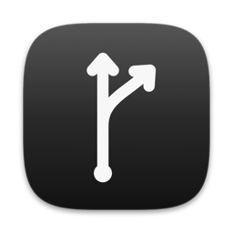
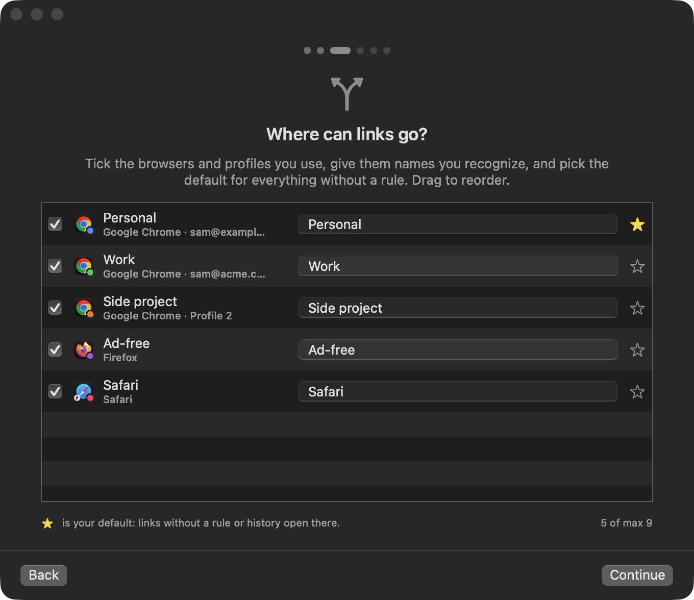
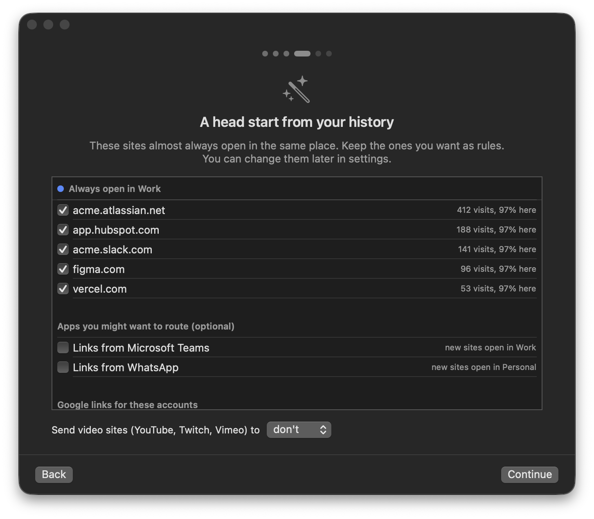

<p align="center">
  
</p>

<h1 align="center">Detour</h1>

<p align="center">
  <strong>Every link opens in the right browser and profile. Automatically.</strong><br>
  A free and open source macOS app by <a href="https://ten50.nl">ten50</a>.
</p>

<p align="center">
  <a href="https://github.com/ten50nl/detour/releases/latest/download/Detour.dmg"><strong>Download for macOS</strong></a>
  ·
  <a href="https://detour.ten50.nl">Website</a>
  ·
  <a href="docs/rules.md">Rules reference</a>
</p>

---

You click a Jira link in Slack and it opens in your personal Chrome profile. A YouTube link from a friend lands in your work browser. Browser pickers fix that by asking you every single time.

Detour sits between your apps and your browsers and decides for you. Work links go to your work profile, video goes to your ad-blocking browser, and everything else opens where you want it. It learns from your own browsing history, so most links need no rule at all, and it only asks when it genuinely can't tell.

<p align="center">
  
</p>

## Features

- **Routes to browser profiles**, not just browsers: Chrome, Brave, Edge, Vivaldi and Chromium profiles, plus Firefox, Safari, Arc or any other browser as a whole.
- **Learns from your history** in Chrome-family browsers, Firefox and Safari. If you open a site in your work profile 95% of the time, Detour already knows where it belongs.
- **Understands Google links.** Calendar invites and `authuser` links carry an email address, and Docs you opened before are remembered per profile.
- **Knows where you clicked.** Send links from Slack or Teams to work and from Messages to personal, or let Detour learn that from your own clicks.
- **Workspace aware.** `github.com/your-company` and `github.com/you` can go to different profiles, same for GitLab, Notion, Linear, Vercel and Figma teams.
- **Cleaner links.** Removes tracking parameters, can open Zoom, Teams and Slack links in their apps, and can send a destination to a private window.
- **Asks only when unsure**, with a small picker at your cursor. Press 1 to 9 to choose. Hold ⌥ while clicking to always choose yourself.
- **Easy to correct.** The menu bar shows your last links. "Open in…" sends one elsewhere and remembers it.
- **Smart start.** Setup suggests rules from your history, so it works well from the first click.
- **Private by design.** No account, no network calls, no analytics. Everything stays on your Mac.
- **Free and open source**, forever. MIT licensed.

## Install

**Download:** get [Detour.dmg](https://github.com/ten50nl/detour/releases/latest/download/Detour.dmg), open it and drag Detour to Applications. It's signed and notarized by Apple.

**Homebrew:**

```sh
brew install --cask ten50nl/tap/detour
```

Requires macOS 15 or later, on Apple silicon or Intel.

## First run

Detour walks you through setup:

1. **Full Disk Access.** macOS keeps browser profiles and history behind this permission. Detour reads them only to list your profiles and to learn where you open each site. You can skip it; Detour then works with whole browsers only.
2. **Destinations.** Pick the browsers and profiles you use, name them ("Work", "Personal", "Ad-free") and choose a default.
3. **Smart start.** Detour suggests rules from your history. Keep what you like.

   

4. **Default browser.** Detour becomes the default browser so it can see links from other apps. Your real browsers don't change.
5. **Optional extras.** Open at login, the menu bar icon, and Accessibility (lets Detour see which window a link came from).

You can run setup again any time from the menu bar.

## How it decides

For every link Detour checks, in order: your rules, Google account hints, choices you taught it, your browsing history, and the app you clicked in. If it has some evidence but nothing clear, for example a Google Doc or a site you used in more than one profile, it asks. Anything else opens in your default destination. The [rules reference](docs/rules.md) has the details and the file format.

## Privacy

- Detour makes no network requests. It opens links, nothing more.
- It reads your browsers' profile list and history files locally to build a small summary: per site, how often you visited it in each destination. Page titles and full URLs are not stored, except for Google file IDs you opened before.
- All settings live in `~/Library/Application Support/Detour/`.

## FAQ

**Can it open a specific Firefox or Safari profile?**
Not yet. Firefox doesn't reliably open a link in another profile while it's running, and Safari profiles have no way in from outside. Both work as a whole browser.

**Does it work with Arc?**
Yes, as a whole browser. Arc's spaces can't be targeted from outside.

**Is it really free?**
Yes. Detour is MIT licensed and there is no paid version, account or tracking. ten50 builds it because we use it ourselves.

**How do I uninstall it?**
Pick another default browser in System Settings → Desktop & Dock → Default web browser, quit Detour from the menu bar, delete it from Applications, and remove `~/Library/Application Support/Detour`.

## Build from source

You need Xcode 16 or later.

```sh
git clone https://github.com/ten50nl/detour.git
cd detour
swift test
scripts/build-app.sh --install
```

`build-app.sh` signs ad-hoc by default. Set `SIGN_IDENTITY` to sign with your own certificate. Note that macOS ties Full Disk Access to the signature, so ad-hoc builds need the permission again after every rebuild.

For development, `DETOUR_CONFIG_DIR=/tmp/detour-test` keeps all settings in a separate folder and leaves your default browser alone.

## Contributing

Issues and pull requests are welcome. Please run `swift test` before opening a pull request. The routing logic lives in `Sources/DetourCore` and is fully unit tested; the app itself is in `Sources/Detour`.

## License

MIT, © ten50. See [LICENSE](LICENSE).
